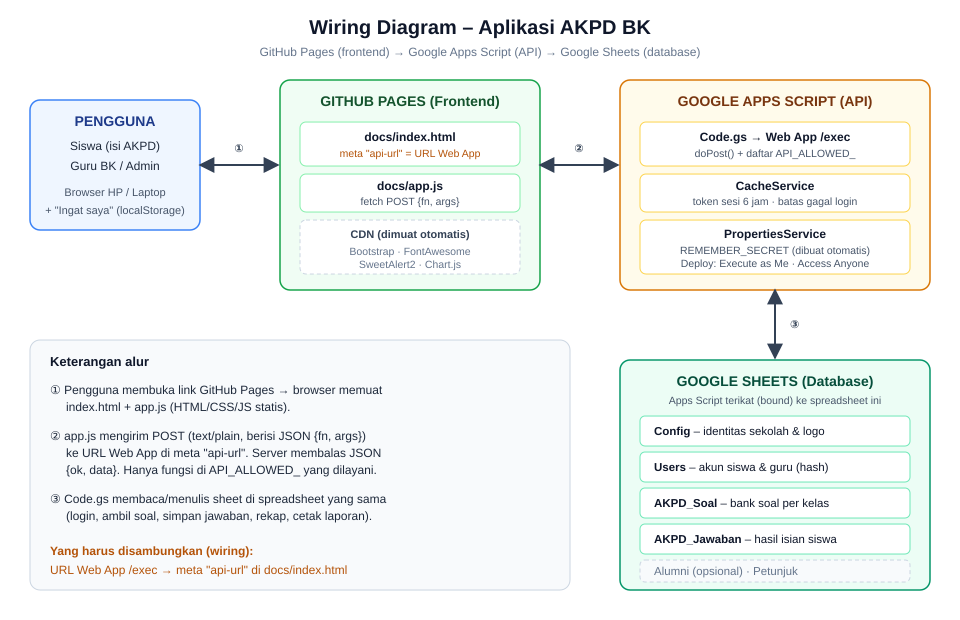

# AKPD BK – Aplikasi Angket Kebutuhan Peserta Didik

Aplikasi web untuk **Guru BK** mengelola Angket Kebutuhan Peserta Didik (AKPD): siswa mengisi angket online, lalu sistem otomatis membuat rekap, profil kelas/konseli, rumusan kebutuhan, tujuan layanan, komponen program, dan action plan yang siap dicetak.

- **Frontend**: HTML + JavaScript statis (di-hosting gratis lewat GitHub Pages)
- **Backend / API**: Google Apps Script
- **Database**: Google Sheets
- **Biaya**: gratis, tanpa server

> Repo ini adalah **template kosong**. Semua identitas sekolah, URL API, dan data pengguna sudah dikosongkan. Isi sendiri mengikuti langkah di bawah.

---

## Fitur

| Peran | Fitur |
|---|---|
| **Siswa** | Login pakai NISN, isi angket sesuai kelas, ganti password |
| **Guru BK / Admin** | Dashboard & grafik, analisa jawaban siswa, profil kelas, profil konseli, rumusan kebutuhan, tujuan layanan, komponen program, action plan (semua bisa dicetak), kelola pengguna (tambah, impor massal, reset password), pengaturan sekolah, menu Akhir Tahun (naik kelas / lulus) |
| **Keamanan** | Password di-hash (SHA-256 + salt), sesi token 6 jam, batas 5x salah login, daftar fungsi API yang diizinkan (`API_ALLOWED_`) |

---

## Struktur Repository

```
akpd-bk/
├── README.md                  ← dokumen ini
└── docs/                      ← semua file sumber
    ├── index.html             ← halaman utama (frontend)
    ├── app.js                 ← logika frontend
    ├── Code.gs                ← backend Google Apps Script
    ├── AKPD_Template.xlsx     ← template database (Google Sheets)
    └── wiring-diagram.svg     ← diagram alur sistem
```

> Folder dinamai `docs` karena GitHub Pages hanya bisa menayangkan dari **root** atau folder **`/docs`**. Dengan begitu README tetap di luar dan file sumber rapi di dalam folder.

---

## Wiring Diagram



**Ringkasan alur:**

1. Pengguna membuka link GitHub Pages → browser memuat `index.html` + `app.js`.
2. `app.js` mengirim permintaan `POST` (JSON `{fn, args}`) ke **URL Web App** Apps Script yang tertulis di `<meta name="api-url">` pada `index.html`.
3. `Code.gs` memproses permintaan, membaca/menulis ke Google Sheets, lalu membalas JSON `{ok, data}`.

**Satu-satunya "kabel" yang harus kamu sambungkan:** URL Web App `/exec` → `meta api-url` di `docs/index.html`.

---

## Struktur Database (Google Sheets)

| Sheet | Isi | Diisi oleh |
|---|---|---|
| `Config` | Nama yayasan, sekolah, alamat, kepala sekolah, guru BK, kota cetak, tahun ajaran, URL logo | Menu **Pengaturan** di aplikasi |
| `Users` | Username/NISN, password (ter-hash), role, nama, kelas | Menu **Pengguna** di aplikasi |
| `AKPD_Soal` | Bank soal: ID, Kelas (X/XI/XII/SEMUA), Aspek (Pribadi/Belajar/Sosial/Karir), pertanyaan, rumusan kebutuhan, tujuan layanan, komponen program, materi layanan | Manual di Sheets |
| `AKPD_Jawaban` | Hasil isian siswa | Otomatis, **jangan diedit** |
| `Alumni` | Data alumni (opsional, belum dipakai oleh kode) | Manual, boleh dihapus |
| `Petunjuk` | Catatan singkat | – |

> Isi `AKPD_Soal` pada template adalah **contoh soal** berkonteks madrasah/pesantren. Ganti atau sesuaikan dengan kondisi sekolahmu. `ID_Soal` harus unik di semua kelas.

---

## Langkah Pemasangan

Siapkan akun **Google** dan akun **GitHub**. Total waktu sekitar 15–20 menit.

### Tahap 1 – Siapkan Database (Google Sheets)

1. Buka [Google Drive](https://drive.google.com) → **New → File upload** → pilih `docs/AKPD_Template.xlsx`.
2. Klik kanan file tersebut → **Open with → Google Sheets**.
3. Di Google Sheets: **File → Save as Google Sheets** (agar menjadi spreadsheet native, bukan `.xlsx`).
4. Ganti nama file sesuai keinginan, misalnya `Database AKPD – Nama Sekolah`.

### Tahap 2 – Pasang Backend (Apps Script)

> Penting: buka Apps Script **dari dalam spreadsheet tadi**, supaya script otomatis terikat ke spreadsheet.

1. Di spreadsheet, klik **Extensions → Apps Script**.
2. Hapus isi file `Code.gs` bawaan, lalu **salin-tempel seluruh isi `docs/Code.gs`** dari repo ini.
3. Klik **Save** (ikon disket).
4. Pilih fungsi `setupDatabase` di dropdown atas → klik **Run** → beri izin akses saat diminta (**Review permissions → pilih akun → Advanced → Go to ... (unsafe) → Allow**).
   Ini membuat sheet yang belum ada dan akun awal `admin`.

### Tahap 3 – Deploy sebagai Web App

1. Klik **Deploy → New deployment**.
2. Klik ikon roda gigi → pilih **Web app**.
3. Isi:
   - **Description**: `AKPD v1`
   - **Execute as**: **Me** (akun kamu)
   - **Who has access**: **Anyone**
4. Klik **Deploy**, lalu **salin Web app URL** (berakhiran `/exec`).
5. Uji: buka URL itu di browser. Jika muncul `{"ok":true,"data":"API AKPD aktif"}` berarti backend berhasil.

### Tahap 4 – Sambungkan Frontend ke Backend

1. Buka `docs/index.html`, cari baris:

   ```html
   <meta name="api-url" content="GANTI_DENGAN_URL_WEB_APP_APPS_SCRIPT">
   ```

2. Ganti nilai `content` dengan URL Web App dari Tahap 3:

   ```html
   <meta name="api-url" content="https://script.google.com/macros/s/XXXXXXXX/exec">
   ```

3. Simpan file.

> URL Web App ini bukan password, tetapi siapa pun yang tahu URL-nya bisa memanggil API. Data tetap dilindungi login dan token, namun jangan sebar URL ke pihak yang tidak perlu.

### Tahap 5 – Upload ke GitHub & Aktifkan GitHub Pages

1. Buat repository baru di GitHub (misal `akpd-bk`).
2. Upload struktur seperti di atas: `README.md` di luar, dan folder `docs/` berisi 5 file.
   - Lewat web: **Add file → Upload files**, seret `README.md` dan folder `docs`.
   - Atau lewat Git:
     ```bash
     git init
     git add .
     git commit -m "Template AKPD BK"
     git branch -M main
     git remote add origin https://github.com/USERNAME/akpd-bk.git
     git push -u origin main
     ```
3. Buka **Settings → Pages**.
4. Pada **Build and deployment → Source**, pilih **Deploy from a branch**.
5. **Branch**: `main`, **Folder**: `/docs` → **Save**.
6. Tunggu 1–2 menit. Aplikasi tayang di:
   `https://USERNAME.github.io/akpd-bk/`

### Tahap 6 – Konfigurasi Awal Aplikasi

1. Buka link GitHub Pages, pilih tab login **Guru**, lalu masuk:
   - Username: `admin`
   - Password: `admin123`
2. **Segera ganti password** admin (menu **Ganti Password**, atau **Reset password** di menu Pengguna).
3. Buka **Pengaturan** → isi nama yayasan, nama sekolah, alamat, kepala sekolah, guru BK, kota, tahun ajaran, dan URL logo.
4. Buka **Pengguna** → tambahkan siswa satu per satu, atau **Impor dari Excel** dengan menempel 3 kolom dari Excel tanpa judul: `NISN, Nama, Kelas`.
   Password awal siswa dibuat otomatis (unduh daftar CSV-nya sebelum menutup jendela).
5. Di Google Sheets, jalankan menu **AKPD → Amankan sheet Users** (sekali saja), untuk memastikan kolom NISN berformat teks dan role berupa dropdown.
6. Edit sheet `AKPD_Soal` bila perlu, lalu bagikan link aplikasi ke siswa.

---

## Cara Memperbarui Aplikasi

| Yang diubah | Yang harus dilakukan |
|---|---|
| `index.html` / `app.js` | Edit di GitHub, commit. Pages otomatis update (tunggu 1–2 menit, tekan Ctrl+F5) |
| `Code.gs` | Salin ke Apps Script → **Deploy → Manage deployments → Edit (pensil) → Version: New version → Deploy**. URL tidak berubah |
| Soal / data | Edit langsung di Google Sheets |

---

## Pemecahan Masalah

| Gejala | Penyebab & solusi |
|---|---|
| "URL API belum diisi" | `meta api-url` di `index.html` belum diganti (Tahap 4) |
| "Respons server tidak valid" | Web App belum di-deploy dengan akses **Anyone**, atau URL salah / bukan `/exec` |
| Perubahan `Code.gs` tidak berefek | Harus deploy **New version**, bukan hanya Save |
| "Mohon jalankan script ini dari dalam Google Sheets" | Apps Script dibuat terpisah. Buka lewat **Extensions → Apps Script** dari spreadsheet |
| Tidak bisa login siswa | NISN di sheet `Users` harus berformat teks. Jalankan **AKPD → Amankan sheet Users** |
| Muncul "Terlalu banyak percobaan" | Tunggu 10 menit (batas 5 kali salah login) |
| Halaman GitHub Pages 404 | Pastikan Pages diarahkan ke branch `main` folder `/docs`, dan `index.html` ada di dalam `docs/` |

---

## Catatan Keamanan

- Jangan simpan data siswa asli di repository GitHub. Data hanya ada di Google Sheets milikmu.
- Ganti password `admin` bawaan sebelum dipakai.
- Spreadsheet jangan dibagikan ke publik. Cukup guru BK yang punya akses.
- `REMEMBER_SECRET` dibuat otomatis di Script Properties dan tidak pernah ada di kode.
- Buat salinan spreadsheet sebelum menjalankan menu **Akhir Tahun** (tindakan permanen).

---

## Kustomisasi

- Teks "Dikembangkan oleh" di `index.html` bisa diganti dengan nama tim/sekolahmu.
- Ubah password awal siswa lewat konstanta `DEFAULT_PW_` di `Code.gs`.
- Kota pada tanda tangan cetak diatur lewat **Pengaturan → Kota**.

## Lisensi

Tentukan sendiri (misalnya MIT) dengan menambahkan file `LICENSE` di root repository.
